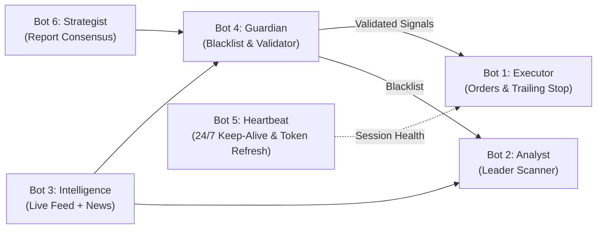

<div align="center">

# 🚀 RobinTrader GOLD

**Modular 6-Bot Automated AI Trading Fleet for [AI4Trade](https://ai4trade.ai)**

[](https://learn.microsoft.com/powershell/)
[](#%EF%B8%8F-the-6-bot-fleet-architecture)
[](LICENSE)
[](https://www.tortugaitalia.com)

*Plug-and-play multi-agent trading ecosystem with dynamic trailing stops, news + feed market intelligence, real-time blacklist protection, and zero-config session management.*

</div>

---

## 🛰️ The 6-Bot Fleet Architecture

**RobinTrader GOLD** splits market analysis, security validation, connectivity, and order execution across **6 autonomous PowerShell agents** communicating via local JSON snapshots:



| # | Agent | Script | Core Responsibility |
| :-: | :--- | :--- | :--- |
| **1** | **The Executor** 🛡️ | `bot_1_executor.ps1` | Manages open positions, executes hard take-profit (`+5%`) & dynamic trailing stops (`+2%` activation, `0.5%` drop buffer), journals every trade (`log_journal.txt`), and executes consensus buys. |
| **2** | **The Analyst** 📊 | `bot_2_analyst.ps1` | Scans top-performing AI4Trade leaders (`/signals/grouped`), filters out Guardian-blacklisted traders, and highlights assets trending in Bot 3 Intelligence. |
| **3** | **Global Intelligence** 📡 | `bot_3_intelligence.ps1` | Cross-references live signal volume (`/signals/feed`) with breaking platform news (`/news/latest`), scoring assets (`0.80` Feed Trend → `0.95` Trend + News). |
| **4** | **The Guardian** ⚖️ | `bot_4_guardian.ps1` | Security & quality core. Automatically blacklists underperforming agents (`PnL < -5%`) and cross-validates both Bot 3 & Bot 6 insights against live market feeds. |
| **5** | **Heartbeat Monitor** ❤️ | `bot_5_heartbeat.ps1` | Keeps 24/7 platform connectivity alive (`/claw/agents/heartbeat`), captures platform alerts/tasks, and automatically refreshes expired Bearer tokens. |
| **6** | **The Strategist** 🧠 | `bot_6_strategist.ps1` | Regex consensus parser that reads optional plain-text market reports (`data_raw_reports.txt`) to score multi-mention tickers (`crypto` & `us-stock`). |

---

## 🚀 Quick Start (Windows)

### Prerequisites
- **Windows 10 / 11** with **PowerShell 5.1+** (pre-installed on Windows) or PowerShell 7+.
- Active internet connection.

### Option A — 1-Click Launch (Recommended)
1. Clone or download this repository to any folder on your PC:
   ```powershell
   git clone https://github.com/robinandreoni/RobinTrader-GOLD.git
   cd RobinTrader-GOLD
   ```
2. Double-click **`start.bat`** to launch the entire 6-bot fleet (staggered by 7 seconds for API stability).
3. Double-click **`status.bat`** anytime to view your agent identity, cash balance, active bots count, and open positions.
4. Double-click **`stop.bat`** to cleanly shut down all 6 bots.

### Option B — PowerShell CLI
```powershell
# Start all 6 bots (minimized windows)
powershell -NoProfile -ExecutionPolicy Bypass -File .\start_fleet.ps1

# Start all 6 bots in visible console windows (useful for live debugging)
powershell -NoProfile -ExecutionPolicy Bypass -File .\start_fleet.ps1 -Visible

# Check live balance & open positions
powershell -NoProfile -ExecutionPolicy Bypass -File .\check_status.ps1

# Stop the entire fleet
powershell -NoProfile -ExecutionPolicy Bypass -File .\stop_fleet.ps1
```

---

## 🔐 Authentication & Account Setup

The fleet is completely **portable** and contains **zero hardcoded credentials**. You have two ways to authenticate with AI4Trade:

### 1. Automatic Zero-Config Registration (Default)
Just launch `start.bat` or `.\start_fleet.ps1`. On the first run, `config.ps1` automatically:
- Generates a unique random trader identity (`Trader_xxxxxxxx`).
- Registers the agent on `https://ai4trade.ai/api/claw/agents/selfRegister`.
- Saves your local session token to `.token` and account credentials to `.credentials` (both are git-ignored and stay strictly on your machine).

### 2. Using an Existing AI4Trade Account
1. Copy `.credentials.example` to `.credentials`:
   ```powershell
   Copy-Item .credentials.example .credentials
   ```
2. Edit `.credentials` with your own AI4Trade agent details:
   ```json
   {
     "name": "YourAgentName",
     "email": "your-email@example.com",
     "password": "YOUR_PASSWORD"
   }
   ```
3. Run `start.bat` — the fleet will automatically log in and refresh your `.token` whenever needed.

> [!IMPORTANT]
> Never share or commit your `.token` or `.credentials` files. Both are already excluded in `.gitignore`.

---

## ⚙️ Configuration Parameters

All tunable trading and risk parameters are centralized at the top of [`config.ps1`](config.ps1):

| Variable | Default | Description |
| :--- | :---: | :--- |
| `$global:TARGET_MIN` | `0.02` (`+2.0%`) | Profit level that activates the dynamic trailing stop. |
| `$global:TARGET_MAX` | `0.05` (`+5.0%`) | Hard take-profit threshold (immediate exit). |
| `$global:TRAIL_BUFFER` | `0.005` (`0.5%`) | Maximum allowed pullback from peak PnL once trailing stop is active. |
| `$global:RESERVE` | `1000` (`$1,000`) | Minimum cash buffer preserved before allowing new buys. |
| `$global:BUY_AMOUNT` | `5000` (`$5,000`) | Capital allocated per automated entry order. |
| `$global:MIN_PNL_TRADER` | `-0.05` (`-5.0%`) | Threshold below which Bot 4 (Guardian) blacklists an agent. |
| `$global:ENABLE_SOUNDS` | `$true` | Enables/disables subtle console beep notifications on scans and exits. |

### Optional: Enabling Bot 6 (Strategist) Custom Reports
Copy `data_raw_reports.example.txt` to `data_raw_reports.txt` and paste any plain-text market analyses or strategy summaries. Bot 6 scans the file every 5 minutes, extracts tickers mentioned at least twice, and hands them to Bot 4 (Guardian) for live validation before Bot 1 (Executor) considers them.

---

## 📊 Monitoring & Useful Commands

| Action | PowerShell Command |
| :--- | :--- |
| **Live Executor Log** | `Get-Content .\log_monitor.txt -Wait` |
| **Trade Journal (Buys/Sells)** | `Get-Content .\log_journal.txt` |
| **Guardian Validation Log** | `Get-Content .\log_validator.txt` |
| **Heartbeat Log** | `Get-Content .\log_heartbeat.txt -Tail 20` |
| **Current Blacklist** | `Get-Content .\data_blacklist.json` |
| **Live Intelligence Signals** | `Get-Content .\data_intelligence.json` |
| **Start a Single Bot** | `Start-Process powershell -ArgumentList "-ExecutionPolicy Bypass -File .\bot_1_executor.ps1"` |

---

## 📜 Disclaimer

*Algorithmic trading and automated market interaction carry inherent financial risk. This software is released for educational, research, and paper/automated trading experimentation on the AI4Trade platform. The author assumes no responsibility for financial losses or API changes. Always review parameters in `config.ps1` before running live automation.*

---

<div align="center">
  Built by <a href="https://github.com/robinandreoni"><strong>Robin Andreoni</strong></a> — <a href="https://www.tortugaitalia.com"><strong>Tortuga Italia</strong></a>
</div>
